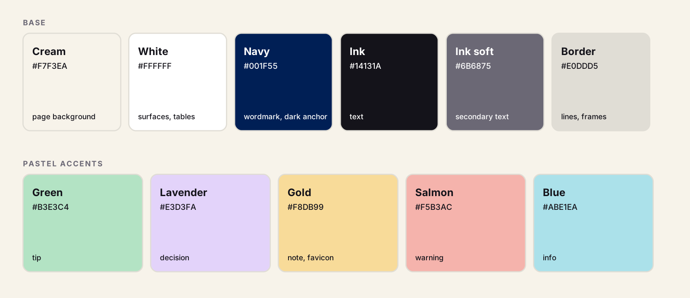

# Flwn Design

Every Flwn surface must look like it came from the same board. Palette reference: `palette/palette.png`. Logo reference: `logo/` (section 6c).

## 0. Surfaces

Same tokens, same palette, same tone on all three.

| Surface | Use | Sections |
|---|---|---|
| Frontend | React app, components, Tailwind, CSS | 2, 3, 4, 5, 5a, 8, 9, 10 |
| Docs | README, specs, proposals, architecture pages | 2, 3, 5a, 6, 6a, 6c, 7 |
| Presentations | Decks, pitch, graduation slides | 2, 3, 5a, 6a, 6b, 6c, 7 |

One shared rule set on all three: same tokens (`palette/tokens.css` is the single source), same radius scale, all sizes in `rem`.

Diagrams (6a) and the logo (6c) appear on all three.

## 1. Feel

- Warm, calm, playful-but-professional. Paper canvas, soft pastel blocks, one dark anchor.
- Flat color blocks. Soft shadows. No gradients, no glassmorphism, no neon.
- Generous spacing. Big bold headline, small quiet metadata.
- Sentence-style headlines ending in a period. Example: "What the team is moving."

## 2. Tokens

Palette v2 is owner-approved. Do not add, shift or "improve" colors. Changes go through the owner.

### Palette (colors)



| Group | Name | Hex | Role |
|---|---|---|---|
| Base | Cream | `#F7F3EA` | page background |
| Base | White | `#FFFFFF` | surfaces, tables |
| Base | Navy | `#001F55` | wordmark, dark anchor |
| Base | Ink | `#14131A` | text |
| Base | Ink soft | `#6B6875` | secondary text |
| Base | Border | `#E0DDD5` | lines, frames |
| Pastel | Green | `#B3E3C4` | tip |
| Pastel | Lavender | `#E3D3FA` | decision |
| Pastel | Gold | `#F8DB99` | note, favicon |
| Pastel | Salmon | `#F5B3AC` | warning |
| Pastel | Blue | `#ABE1EA` | info |

Also in `palette/palette.svg`. `palette/tokens.css` mirrors this block exactly. Copy from it, never retype.

```css
:root {
  /* base */
  --cream: #F7F3EA;          /* page background */
  --white: #FFFFFF;
  --navy: #001F55;           /* logo, wordmark, dark anchor */
  --ink: #14131A;            /* text */
  --ink-soft: #6B6875;       /* secondary text on cream or white only */

  /* pastel accents */
  --pastel-green: #B3E3C4;
  --pastel-lavender: #E3D3FA;
  --pastel-gold: #F8DB99;    /* UI accent, favicon circle */
  --pastel-salmon: #F5B3AC;
  --pastel-blue: #ABE1EA;

  /* derived neutrals */
  --border: #E0DDD5;         /* 10% ink over cream */
  --dot: #D3CFC9;            /* dotted grid, 16% ink over cream */
  --ink-72: rgba(20, 19, 26, .72);   /* secondary text on pastel cards */

  /* shape: the only radii. Everything else is 50% (circles) or 999px (pills) */
  --r-sm: 0.375rem;          /* chips, pills, tags */
  --r: 0.625rem;             /* cards, columns, buttons, banners, callouts, code, frames, tabs */
  --shadow: 0 0.125rem 0 rgba(20,19,26,.06), 0 0.5rem 1.125rem rgba(20,19,26,.08);

  /* spacing scale (rem, 1rem = 16px) */
  --s-1: 0.25rem; --s-2: 0.5rem; --s-3: 0.75rem; --s-4: 1rem;
  --s-5: 1.25rem; --s-6: 1.5rem; --s-8: 2rem; --s-10: 2.5rem;
  --s-12: 3rem; --s-16: 4rem;
  --max: 80rem;              /* max content width */
  --measure: 42rem;          /* max text line length */

  /* line widths stay px (hairlines must not scale) */
  --line: 1.5px;
}
```

Retired: purple `#D9C7F2` (now lavender), gold `#F3C868` (now `#F8DB99`).

Contrast (computed, WCAG relative luminance):
- Ink on pastels: green 12.9, lavender 13.2, gold 13.7, salmon 10.5, blue 12.9. Ink on cream 16.7, on white 18.5.
- Navy on pastels: green 11.1, lavender 11.3, gold 11.7, salmon 9.0, blue 11.1. Navy on cream 14.3, on white 15.8.
- Ink soft on cream 4.9. On pastels only 3.1 to 3.8, so never use it there. Use `--ink-72` on pastel cards.
- Pastel on pastel is about 1.0 to 1.1. Never rely on one pastel to separate from another.

Dark mode: not defined. Do not invent one unless asked.

### Units and radius (all surfaces)

- Every size, space, radius, font size and shadow offset is `rem`. Root stays 16px: `1rem` = 16px. Never set `html { font-size }` below 100%.
- `px` only for hairlines (borders, dotted-grid dots, dashed outlines), never for layout or type.
- Two radii only: `--r-sm` 0.375rem and `--r` 0.625rem. Circles use `50%`, pills `999px`. No 8, 12, 14 or other one-off radii.
- Tailwind: `rounded-flwn-sm`, `rounded-flwn`, `rounded-full`. No `rounded-lg`, `rounded-xl`, arbitrary `rounded-[..]`.
- Docs and decks follow the same radii (callouts, code blocks, cards, tables).
- HTML decks use rem with 1rem = 16px at 1920px wide. PPTX / Keynote use the pt sizes in 6b and the same radii scaled to the slide.

## 3. Type

- Font: Plus Jakarta Sans, fallback Inter, system-ui. Mono for code: JetBrains Mono.
- Page headline: 2.5-3rem, weight 700, tracking -0.01em, ink.
- Eyebrow: 0.8125-0.875rem, weight 600, uppercase, letter-spacing .12em, `--ink-soft`.
- Card title: 1.125-1.25rem, weight 600.
- Column title: 1.125rem, weight 600, count 0.9375rem `--ink-soft`.
- Meta: 0.875-0.9375rem, `--ink-72` on pastel, `--ink-soft` on cream or white.
- Chips: 0.75rem, weight 600.

## 4. Components

**Canvas.** `--cream` with dotted grid (`radial-gradient(circle, var(--dot) 1.3px, transparent 1.4px)`, 1.5rem tile). Thin `--line` `--border` rounded frame (inset 0.5rem, radius `--r`).

**Task card.** Solid pastel fill, no border, radius `--r`, padding 1.5rem, `--shadow`, min-height 11rem.
- Top row: white category chip (Research, Design, Product, Engineering) left, `...` menu right in `--ink-72`.
- Title below, margin-top 1.125rem.
- Optional 0.25rem progress bar: track `rgba(255,255,255,.6)`, fill `--ink`.
- Footer: 2.125rem white initials avatar, date, message count right-aligned (`4 msg`).
- "Today" = white pill, ink, weight 700. No red anywhere.

**Column header.** White, `--line` `--border`, radius `--r`, height 3.375rem. 0.75rem rounded-square dot (radius 0.1875rem) (pastel) + title + count + `+` right.
- Backlog = gold, Planned = blue, In progress = salmon.

**Add task.** Dashed `--line` border at ink 35%, radius `--r`, transparent, centered `+ Add task` in `--ink-soft`.

**AI banner.** Gold strip, radius `--r`, 2.75rem navy circle `AI` in cream, bold "Daily sum-up", one-line summary in `--ink-72`, ellipsis. Top center.

**Workspace switcher.** Blue block, radius `--r`, label + chevron, overlaps the banner's right edge.

**Primary button.** `--ink` fill, `--cream` text, radius `--r`, 1.5rem text. Example: "Meet". This plus the AI avatar are the only dark elements. Navy may replace ink for the fill, never both on one view.

**Avatar stack.** 1.875rem pastel circles, 2-letter initials, `--line` cream ring, overlapped slightly.

**Side tabs.** Pennant shapes (right corners radius `--r`) pinned to the left edge, stacked, gold / salmon / green, ink icons only (pointer, frame, comment).

**User badge.** Bottom-left, 3.25rem lavender circle, navy initials, white 2px ring, `--shadow`.

## 5. Layout

- Page: eyebrow, headline, then board. 3 equal columns, 2.5rem gaps. Max 4 columns.
- Cards stack with 1.25rem gap.
- Top-right cluster: avatars + primary action.
- Left rail minimal: 3-5 tabs max.

## 5a. Spacing, padding, margins and centering

All surfaces. Values come from the `--s-*` scale only (0.25, 0.5, 0.75, 1, 1.25, 1.5, 2, 2.5, 3, 4rem). No other spacing value.

### Padding (inside a box)

| Element | Padding |
|---|---|
| Chip, tag | 0.25rem 0.5rem |
| Button | 0.75rem 1.5rem |
| Input | 0.75rem 1rem |
| Table cell | 0.75rem 1rem |
| Column header, banner | 0 1.25rem (height fixed, content centered) |
| Callout | 1.25rem 1.5rem |
| Code block | 1.25rem 1.5rem |
| Card | 1.5rem, same on all four sides |
| Page gutter | 1rem mobile, 2.5rem tablet, 4rem desktop |

- Padding is never smaller than the box's radius. A `--r` box has at least 0.625rem.
- Inner padding is equal left and right. Top and bottom may differ from sides, never from each other unless a footer or bar is pinned.
- Nested boxes: inner padding is the same or smaller than the outer one.

### Margins and gaps (between boxes)

- Space between siblings is the parent's `gap` (flex or grid). Do not give siblings margins.
- Margin is only for flow text (top margin on a heading or paragraph) and for centering (`margin-inline: auto`).
- No negative margins. One exception: the avatar stack overlap.
- Vertical rhythm:

| Between | Space |
|---|---|
| Eyebrow and headline | 0.5rem |
| Headline and content | 2rem |
| Card title and content | 1rem |
| Paragraphs | 1rem |
| Cards in a column | 1.25rem |
| Columns | 2.5rem |
| Page sections | 4rem |
| Callout or code block and neighbours | 1.5rem |

- Closer means related. Gaps grow as the relationship loosens, never shrink going down the page.

### Centering

- Page content: one wrapper, `max-width: var(--max)`, `margin-inline: auto`, gutters from the page gutter row. Left and right gutters are always equal.
- Docs body text: `max-width: var(--measure)`, left aligned.
- Centered text is allowed only for: title slide and section divider headlines, empty states, login or single-action cards, button labels, and short stat numbers. Everything else is left aligned.
- Table numbers are right aligned, text left aligned.
- Center a box with flex or grid: `display: grid; place-items: center`, or `margin-inline: auto` on a fixed-width block. Never `position: absolute` with `top: 50%` and `translate`, and never nudge with padding or margin.
- Center content inside controls (buttons, chips, avatars, the `+` and `AI` circles, tabs) with `display: grid; place-items: center` or flex `align-items: center`. Icon plus label rows: flex, `align-items: center`, gap 0.5rem.
- Center vertically with `min-height: 100dvh` and flex or grid. Never `100vh`.
- Optical fix only for glyphs that look off after real centering (play arrow, `+`): shift 0.0625rem at most, and comment why.
- Slides: eyebrow and title are top-left on the 4rem safe margin. The card row is centered horizontally with equal side margins. The dark anchor is left aligned with the title or centered under the cards, one or the other per deck.
- Keep one alignment edge per column. Eyebrow, headline and first card share the same left edge.

## 6. Docs and README

- Page bg `--cream`, body text `--ink`, secondary `--ink-soft`.
- Each doc starts with an eyebrow (section name) plus a bold sentence-style title with a period.
- Callouts = pastel blocks, radius `--r`, no border: green = tip, gold = note, salmon = warning, blue = info, lavender = decision.
- Tables: white surface, `--line` `--border`, radius `--r` on the outer frame, no zebra, header weight 600.
- Code blocks: `--ink` bg, cream text, radius `--r`.
- Diagrams: section 6a. Slides: 6b. Logo: 6c.
- README: no emoji. Short sentences. Same tone as UI copy.

## 6a. Diagrams (hand-drawn architecture style)

Every architecture, flow and data diagram in Flwn docs and slides uses this style. Reference: the Frontend / Backend (Go) / AI Engine / Data Engine system map. Diagram hues are a deliberate exception to the palette, because zones need more distinct layers than the pastels give.

### Look

- Hand-drawn, Excalidraw look. Font: Excalifont (fallback Virgil, "Comic Neue"). Roughness low, stroke 2px, rounded corners (diagram shapes are exempt from the two-radius rule).
- Layered zones: large rounded rectangles, pale tint fill, 1px lighter border. Zone title top-left, uppercase, in the zone's dark hue, optional ownership rule after a colon (`BACKEND (Go): all connections + sockets, owns no data`).
- Nodes: rounded rectangles, saturated-pastel fill, 2px stroke of the same hue (darker), text in that dark hue. No black text inside nodes.
- Node text = title line + 1-2 short descriptor lines, centered. Max 3 lines.
- Stores (DBs, vector stores) = cylinders.
- Sub-groups = dashed rounded box with small label top-left.
- Cross-cutting rules = dashed rounded box at the bottom of the zone.
- Canvas behind diagram: transparent or `--cream`. No dot grid inside diagrams.

### Zone + node palette (by system layer)

| Layer | Zone fill | Zone border | Node fill | Stroke + text |
|---|---|---|---|---|
| Frontend | `#F3F4FF` | `#BFD4F5` | `#A5D8FF` | `#1E78D6` |
| Backend (Go) | `#F0FBF2` | `#B7E8C3` | `#B2F2BB` | `#1B7A33` |
| AI Engine | `#F5F0FE` | `#D9C9F5` | `#D0BFFF` | `#5B3FD0` |
| Data Engine | `#EDFCF8` | `#B5EDE0` | `#96F2D7` | `#0C8599` |
| Agents / Ghost Engineer | `#FBF3E3` | `#F3D9A6` | `#FFD8A8` / `#FFF3BF` | `#C2680A` |
| Decision / risk (Ledger) | none | none | `#FFC9C9` | `#C92A2A` |
| Behavioral / analysis | none | none | `#F3A8F0` | `#C2255C` |

Rules:
- One hue per layer. A node takes the hue of the layer that owns it, even if drawn inside another zone's bounds.
- Agents are always orange-family wherever they appear.
- External services keep their own tint: Azure OpenAI blue, Cohere orange, Qdrant / PostgreSQL teal cylinders.
- New layer? Pick a hue not in the table, fill it light, stroke and text 35% darker, add it here.

### Arrows

- Color: `--ink`, 2px, open arrowheads.
- Direct one way: solid, single head. Direct two way: solid, heads both ends.
- Indirect (via another layer): dotted `--ink-soft`, single head, path stated in the label.
- Loops (rework, retries): orthogonal solid arrow, short label in the owning hue.
- Labels: small, ink, on the line, no box. Say what travels (`msgs / replies`, `jobs / status`), not "calls".
- Avoid crossing arrows. Reroute with elbows first.

### Legend

Any diagram with more than one arrow type starts with a top-left legend: solid single `Direct, one way`, solid double `Direct, two way`, dotted `Indirect (via <layers>)`.

### Layout and delivery

- Zones stack top to bottom: Frontend, Backend, AI Engine. Shared data layer gets a full-height column on the right.
- Entry node centered at top of its zone, children fan out below.
- Max about 25 nodes per diagram. Split and link past that.
- Build with the Excalidraw tool when available. Export SVG, keep the `.excalidraw` source in `docs/diagrams/`.
- Embed at full content width with a one-line meta-style caption.
- No Mermaid, PlantUML or draw.io default themes. If Mermaid is unavoidable, apply this palette via `themeVariables` and `classDef` and note it is a fallback.

## 6b. Presentations

- 16:9. `--cream` background with the dotted grid on every slide. Thin rounded frame optional.
- Every slide: eyebrow (section name, uppercase, `--ink-soft`) + bold sentence-style title ending with a period. Example: `ARCHITECTURE` / "One path between agents."
- Content lives in pastel cards (radius `--r`, `--shadow`, no border). One idea per card, max 3 cards for text, max 4 for stats.
- Cycle card colors: green, lavender, gold, salmon, blue. No two identical neighbors.
- Exactly one dark anchor per slide: a navy or ink pill or button-style element with cream text (key takeaway or next step).
- Type: title 44-56pt, card title 24-28pt, body 18-20pt minimum, meta 14pt. Nothing smaller.
- Max about 25 words per card. Fragments, no paragraphs.
- Title slide: eyebrow, huge headline, avatar stack of presenters, small meta, wordmark.
- Section dividers: full pastel background, headline only.
- Architecture slides: one diagram per slide in 6a style, full width, legend visible. Split big diagrams by zone.
- Roadmap / status slides: reuse the kanban look.
- Speaker notes carry the detail.
- No stock photos, clip art, gradients, emoji or bullet walls.
- Export PDF for sharing, keep source in `docs/decks/`.

## 6c. Logo

Files live in `flwn-design/logo/`. Use them as delivered. Never redraw, retype, recolor or rebuild.

### The logo

- The logo is the `flwn` wordmark only. No symbol, no tile, no lockup.
- Two versions: navy `#001F55` on light grounds, white `#FFFFFF` on navy.
- Outlined to paths, cropped tight. Never set it as live text.

| File | Use |
|---|---|
| `logo/flwn-wordmark-navy.svg` (+ `-1600.png`) | Cream, white, lavender, gold, green, salmon, blue |
| `logo/flwn-wordmark-white.svg` (+ `-1600.png`) | Navy only |

### Favicon

- The favicon is the gold circle mark: `#F8DB99` circle, navy `f`, navy dot lower right.
- Favicon, app icon and browser tab only. Never in a header, cover, slide or doc body.
- One drawing, shipped at the sizes each place needs. Each context renders at a different pixel size, so one raster would blur somewhere.

| File | Where |
|---|---|
| `logo/flwn-favicon-gold.svg` | Modern browser tabs, scales to any size |
| `logo/favicon.ico` (16, 32, 48 inside) | Legacy browsers, bookmarks, Windows |
| `logo/apple-touch-icon-180.png` | iOS home screen |
| `logo/pwa-192.png`, `logo/pwa-512.png` | Only if the app is a PWA (manifest) |

- Without a PWA, ship the first three only.
- Gold circle is faint on light tab backgrounds: 1.22:1 on cream, 1.35:1 on white. Navy `f` carries the shape. Never darken or outline the circle.
- The dot is about 1px at 16px and may blur.

### Contrast (computed)

- Navy wordmark: cream 14.3:1, white 15.8:1, lavender 11.3:1, gold 11.7:1, green 11.1:1, salmon 9.0:1, blue 11.1:1.
- White wordmark on navy 15.8:1. On any light ground 1.0 to 1.8:1, so never.
- Navy `f` on the gold circle 11.7:1.

### Placement

- Frontend: wordmark top-left of the app shell, sidebar header and login screen. Favicon in the browser tab.
- Docs: wordmark top-left of cover and README header (1.5-2rem tall). Favicon for the docs site.
- Presentations: wordmark on the title slide and bottom-left of other slides.

### Size and space

- Min size: wordmark 4rem wide.
- Clear space: at least the `l` stroke width on all sides.

### Don't

- Stretch, rotate, shadow, outline or add a stroke.
- Recolor the wordmark, or the favicon's circle, `f` or dot.
- Put the navy wordmark on navy or the white wordmark on a light ground.
- Add the circle mark, a tile, or a symbol next to the wordmark.
- Use the favicon as the main logo.
- Use the Blocks mark or any earlier logo.
- Put on busy photos, or in gradients.

## 7. Copy tone

- Plain, short, human. Sentence case everywhere except proper nouns.
- Status words: Backlog, Planned, In progress, Done.
- Metadata terse: `Aug 28`, `4 msg`, `Tomorrow`.

## 8. Rules

Do:
- Cycle pastel colors across cards. Avoid identical neighbors in a column.
- Keep one dark element per view as the anchor (diagram-free views: Meet button; AI avatar is the allowed second).
- Use CSS variables or Tailwind tokens. Never hardcode hex in components.
- Ink on pastel only. Navy on pastel is also allowed. Secondary text on pastel is `--ink-72`.

Don't:
- No colors outside section 2 (diagrams excepted, and the logo uses only the colors listed in 6c).
- No red, orange or green status colors. Status = pastel squares, "Today" = white pill.
- No gradients, neon, pure black `#000`, or grey backgrounds.
- No heavy borders on cards. Color is the container.
- No shadow stacks beyond `--shadow`.
- No px for layout or type. No radii outside `--r-sm`, `--r`, `50%`, `999px`.
- No emoji in UI or docs.
- No white text on pastel.

## 9. Build checklist

1. Tokens come from section 2 or the Tailwind block below.
2. Headline bold, sentence-style, ends with a period.
3. Eyebrow present, uppercase, `--ink-soft`.
4. Cards: pastel fill, radius `--r`, `--shadow`, no border.
5. Dark elements limited to the Meet-style button and AI avatar.
6. Dotted cream canvas visible behind content.
7. Logo from `logo/`, unmodified. Wordmark only. Gold favicon only in the browser tab.
8. Mobile: columns collapse to one, side tabs become a bottom bar.
9. Units are rem. Only `--r-sm` and `--r` radii. No raw px outside hairlines.
10. Compare with the palette reference `palette/palette.png`.

## 10. Tailwind starter

```js
// tailwind.config.js (extend)
colors: {
  cream: '#F7F3EA',
  white: '#FFFFFF',
  navy: '#001F55',
  ink: { DEFAULT: '#14131A', soft: '#6B6875' },
  pastel: {
    green: '#B3E3C4',
    lavender: '#E3D3FA',
    gold: '#F8DB99',
    salmon: '#F5B3AC',
    blue: '#ABE1EA',
  },
  line: '#E0DDD5',
  grid: '#D3CFC9',
},
borderRadius: { 'flwn-sm': '0.375rem', flwn: '0.625rem' },
boxShadow: { flwn: '0 0.125rem 0 rgba(20,19,26,.06), 0 0.5rem 1.125rem rgba(20,19,26,.08)' },
fontFamily: { sans: ['"Plus Jakarta Sans"', 'Inter', 'system-ui', 'sans-serif'] },
```

Usage: `bg-pastel-green`, `bg-pastel-lavender`, `bg-cream`, `text-ink`, `text-navy`, `text-ink-soft`, `border-line`, `rounded-flwn`, `rounded-flwn-sm`, `shadow-flwn`. Tailwind spacing is already rem. Secondary text on pastel: `text-ink/70`.
